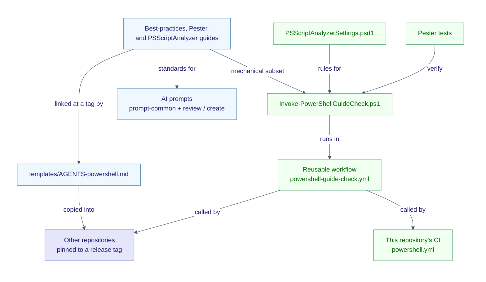
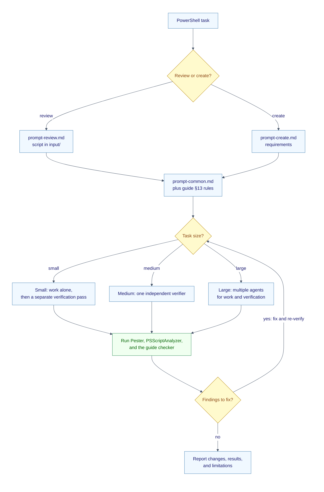
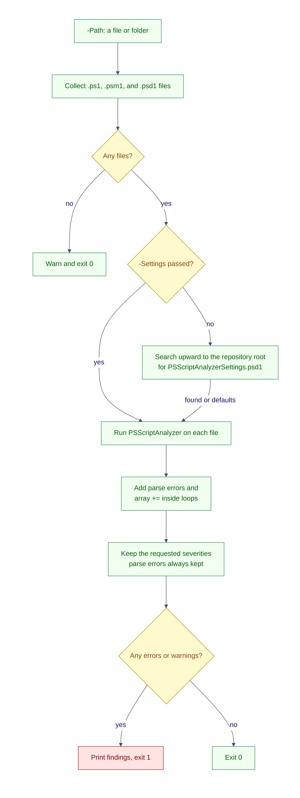
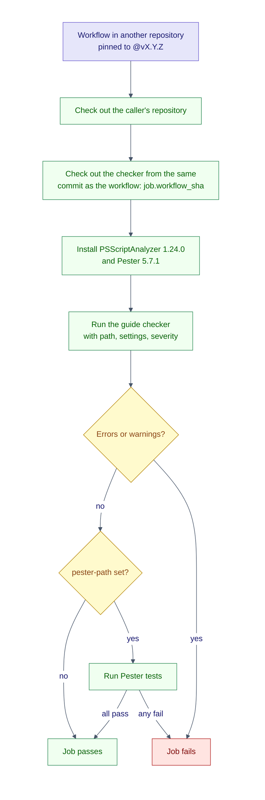

# PowerShell Engineering Guides and Tools

This repository provides practical standards for writing, reviewing, testing, and maintaining PowerShell scripts and modules. It includes focused guides, reusable AI prompts, and a checker for a mechanically verifiable subset of the recommendations.

## How the pieces fit together



Colors are the same in every diagram: blue for documents and prompts, green for scripts, settings, and CI steps, purple for other repositories, yellow for decisions, and red for failure paths.

## Start here

1. Read [PowerShell Best Practices](powershell-best-practices.md).
2. Use the [Pester testing guide](powershell-pester-testing.md) and [PSScriptAnalyzer guide](powershell-psscriptanalyzer.md) for verification practices.
3. For AI-assisted work, combine [shared prompt instructions](prompt-common.md) with either the [script review prompt](prompt-review.md) or [script creation prompt](prompt-create.md).
4. Run the guide checker and Pester tests using the commands below.

An AI agent using the prompts follows this workflow. The task size decides how many agents do the work and the verification:



## Guides and tools

- [PowerShell Best Practices](powershell-best-practices.md) — scripting, modules, security, testing, documentation, and AI-agent practices.
- [Pester testing guide](powershell-pester-testing.md) — Pester v5 test design, mocks, discovery, TestDrive, coverage, and CI.
- [PSScriptAnalyzer guide](powershell-psscriptanalyzer.md) — analyzer configuration, compatibility checks, formatting, suppressions, and CI.
- [Mermaid conventions](reference/mermaid-best-practices.md) — how to write, render, and verify the Mermaid diagrams in this repository.
- [PSScriptAnalyzer](https://learn.microsoft.com/en-us/powershell/utility-modules/psscriptanalyzer/using-scriptanalyzer?view=ps-modules) — the PowerShell linter and static analyzer used by this project.
- [Guide check script](Invoke-PowerShellGuideCheck.ps1) — runs PSScriptAnalyzer and supplemental AST checks for selected guide rules.
- [Shared AI prompt](prompt-common.md) — workflow tiers scaled to task size, verification, Mermaid diagrams, and reporting; builds on §13 of the guide.
- [AI script review prompt](prompt-review.md) — review an existing script, typically supplied under `input/`.
- [AI script creation prompt](prompt-create.md) — design and create a script from requirements.

## Requirements

- PowerShell 7 or later.
- PSScriptAnalyzer 1.24.0 for static analysis and the guide checker.
- Pester 5.7.1 for the repository's Pester tests.

These are the versions pinned in CI (`.github/workflows/powershell.yml`). To install them for your user account from the PowerShell Gallery, run in `pwsh`:

```powershell
Install-Module -Name PSScriptAnalyzer -RequiredVersion 1.24.0 -Scope CurrentUser -Repository PSGallery
Install-Module -Name Pester -RequiredVersion 5.7.1 -Scope CurrentUser -Repository PSGallery -SkipPublisherCheck
```

PowerShell asks you to confirm installing from an untrusted repository; answer `Y`. `-SkipPublisherCheck` is needed on Windows, where an older Pester 3.4 signed by Microsoft ships with Windows PowerShell; it is harmless elsewhere. Confirm the installed versions with:

```powershell
Get-Module -ListAvailable PSScriptAnalyzer, Pester | Select-Object Name, Version
```

If your organization uses an internal repository or another approved setup method, use that instead. When you change a pinned version, update both this section and the workflow. The checker never installs modules.

## Lint and run static checks

From the repository root, run:

```powershell
./Invoke-PowerShellGuideCheck.ps1 -Path .
```

PSScriptAnalyzer is the project's linter. The checker uses the nearest `PSScriptAnalyzerSettings.psd1`, searching upward from the target path to the repository root, unless `-Settings` is passed. It exits nonzero for errors and warnings; informational findings require review. Static checks cannot determine whether a design fits its threat model or fully verify runtime behavior.



## Run tests

From the repository root:

```powershell
Invoke-Pester -Path ./Tests -Output Detailed
```

The tests invoke the checker in a child `pwsh` process and require PSScriptAnalyzer to be available to that process.

GitHub Actions runs the guide checks and Pester suite on both Ubuntu and Windows for pushes and pull requests. The workflow pins Pester and PSScriptAnalyzer versions so changes in tool releases do not silently alter results. This repository's CI calls the same reusable workflow that other repositories use, so every push also tests it.

## Use in other repositories

Pin a release tag so guide updates never change another repository's rules unexpectedly.

**AI agent instructions.** Copy the section in [templates/AGENTS-powershell.md](templates/AGENTS-powershell.md) into the other repository's `AGENTS.md` or `CLAUDE.md`. It links the guides at a pinned tag and tells agents which checks to run.

**CI.** Call the reusable workflow from a workflow in the other repository:

```yaml
name: PowerShell

on:
  push:
  pull_request:

permissions:
  contents: read

jobs:
  powershell:
    uses: scufflegrits/powershellai/.github/workflows/powershell-guide-check.yml@v1.1.0
    with:
      pester-path: ./Tests   # omit to skip Pester
```

Optional inputs: `path` (default `.`), `settings` (default: nearest `PSScriptAnalyzerSettings.psd1`, otherwise PSScriptAnalyzer defaults), `severity` (default `Error,Warning`), and `os` (JSON array, default `["ubuntu-latest", "windows-latest"]`). The workflow uses the checker and tool versions from the tag you pin. To adopt this repository's analyzer rules, copy [PSScriptAnalyzerSettings.psd1](PSScriptAnalyzerSettings.psd1) into the other repository's root.

Each job of the reusable workflow runs these steps once for every operating system in `os`:



## Repository layout

- `.github/workflows/` — `powershell-guide-check.yml` (reusable workflow) and `powershell.yml` (this repository's CI).
- `templates/` — material to copy into other repositories.
- `reference/` — supporting guides, such as the Mermaid diagram conventions, and optional Mermaid audit scripts in `reference/scripts/`.
- `input/` — place scripts here when using the review prompt.
- `Tests/` — Pester tests for the guide checker.
- `PSScriptAnalyzerSettings.psd1` — shared static-analysis settings.
- `CHANGELOG.md` — notable guide and tool changes.
- `RELEASING.md` — steps for tagging and publishing a release.

The prompts are templates; fill in task requirements and constraints before use. The review prompt should not modify a script unless the requested task authorizes updates.

## Guide versions

Guide filenames are stable; each guide carries its own `Guide version` header and is versioned independently. Changes are recorded in [CHANGELOG.md](CHANGELOG.md), and releases are marked with git tags (for example, `v1.1.0`). Use `git log -- <guide>.md` or check out a tag to see an earlier revision. To cut a release, follow [RELEASING.md](RELEASING.md).
