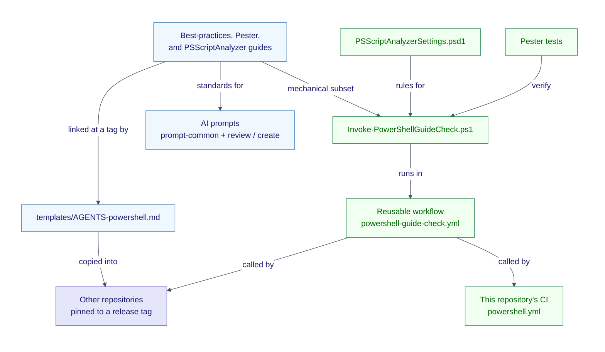
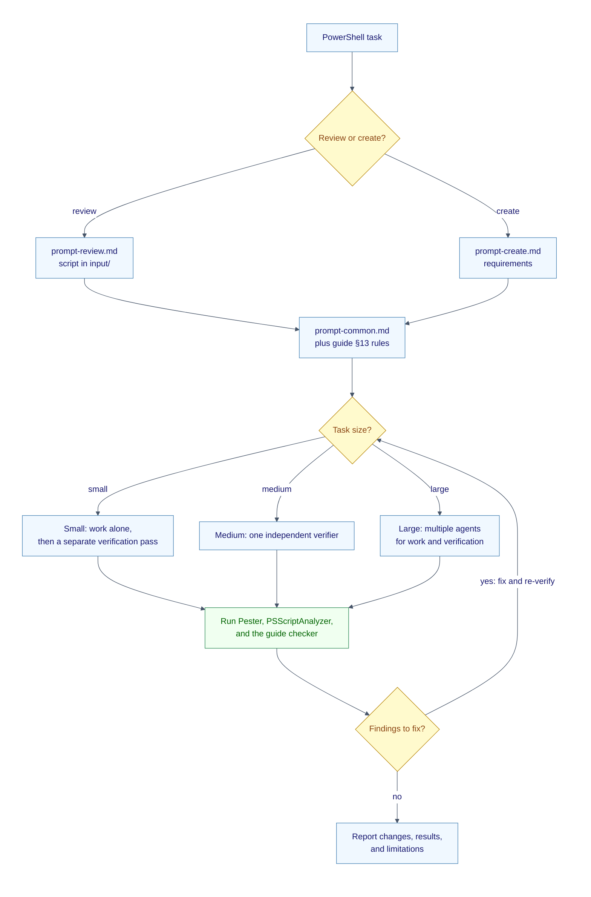
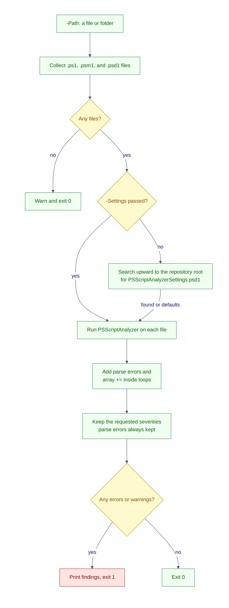
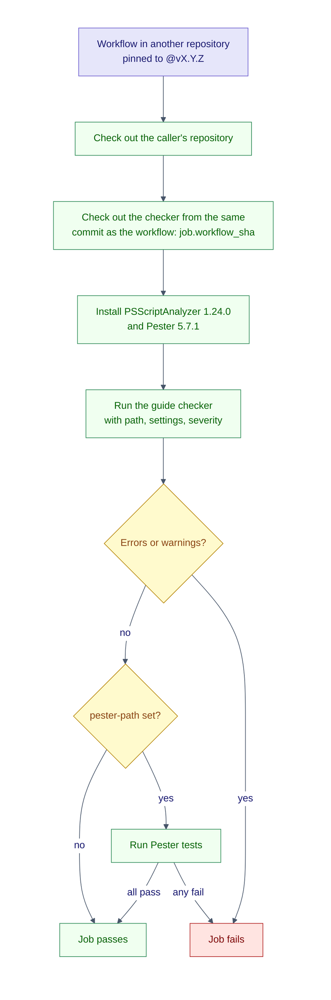

# PowerShell Engineering Guides and Tools

This repository helps people and AI assistants write PowerShell that is safe, readable, and tested. PowerShell scripts often change real systems, such as files, services, and user accounts, so a small mistake can cause real damage. The repository gives you three things:

- **Guides**: written standards that say what good PowerShell looks like and why.
- **AI prompts**: ready-made instructions that make an AI assistant follow those guides when it reviews or writes a script, and show its evidence instead of only claiming that the work is correct.
- **Automated checks**: a script that finds the mistakes a computer can detect on its own. GitHub runs it on every change.

The automated checks find only some problems. Whether a script does the right thing still needs tests and review by a person or an AI.

## Words used in this README

- **Module**: a packaged set of PowerShell commands that can be installed and shared, such as Pester.
- **Linter (static analysis)**: a tool that reads code without running it and flags likely mistakes. PSScriptAnalyzer is the standard linter for PowerShell.
- **Pester**: PowerShell's testing framework. A test runs code and checks that the result is what you expected.
- **CI (continuous integration)**: checks that run automatically on GitHub every time someone pushes a change. This repository uses GitHub Actions for CI.
- **AI agent**: an AI assistant, such as Claude or GitHub Copilot, that can read files and run commands in a repository.
- **Release tag**: a fixed name, such as `v1.1.0`, for one exact version of this repository. A tag never changes, so anything that refers to it gets the same files every time.
- **Mermaid**: a text format for diagrams. GitHub draws Mermaid text as a picture, which is how the diagrams below appear.

## How the pieces fit together

Read this diagram from top to bottom. The guides at the top define the rules; everything below them uses those rules.



Colors are the same in every diagram: blue for documents and prompts, green for scripts, settings, and CI steps, purple for other repositories, yellow for decisions, and red for failure paths.

## Start here

Pick the path that matches what you are doing:

- **Writing or reviewing PowerShell yourself.** Read [PowerShell Best Practices](powershell-best-practices.md) first. It is the standard everything else in this repository is built on. Read the [Pester testing guide](powershell-pester-testing.md) when you add tests, and the [PSScriptAnalyzer guide](powershell-psscriptanalyzer.md) when you set up automated checks.
- **Asking an AI to review or write a script.** Give the AI [prompt-common.md](prompt-common.md) together with either [prompt-review.md](prompt-review.md) or [prompt-create.md](prompt-create.md). First replace the placeholders in angle brackets, such as `<what the script should do>`: the prompts are templates, and the AI cannot guess your requirements. The review prompt does not change your script unless you ask it to.
- **Changing this repository.** Install the [requirements](#requirements), then run the [checks](#check-your-code-with-the-linter) and [tests](#run-the-tests) before you push.

When an AI follows the prompts, it works like this. It first judges how big the task is. A small task gets one careful pass followed by a separate check. A large task gets several AI agents, with different agents checking the work, because an agent tends to miss its own mistakes. Every path ends with real checks, because an AI saying a script works is not proof that it does.



## Guides and tools

- [PowerShell Best Practices](powershell-best-practices.md): the main standard. It covers naming, parameters, error handling, security, previewing changes with `-WhatIf`, testing, and rules for AI agents. Shared rules make scripts predictable and easier to review, and they give an AI a concrete standard to follow instead of its own habits.
- [Pester testing guide](powershell-pester-testing.md): how to write and run tests with Pester. Tests show that a script does what it should and keeps doing it after later changes. Scripts that change systems need them most.
- [PSScriptAnalyzer guide](powershell-psscriptanalyzer.md): how to set up and use the linter. A linter catches common mistakes automatically, before anyone spends time reviewing the code.
- [PSScriptAnalyzer documentation](https://learn.microsoft.com/en-us/powershell/utility-modules/psscriptanalyzer/using-scriptanalyzer?view=ps-modules) (Microsoft): the official reference, for when you need details about a rule that the guide does not cover.
- [Guide check script](Invoke-PowerShellGuideCheck.ps1) (`Invoke-PowerShellGuideCheck.ps1`): runs PSScriptAnalyzer plus a few extra checks for guide rules that PSScriptAnalyzer does not cover, such as code that cannot be parsed and arrays grown inside loops, which is slow. It gives you one command for every automated check, and it runs the same way on your computer and on GitHub.
- [Shared AI prompt](prompt-common.md): rules for every AI task. It sets how much checking a task needs, how to verify the work, and how to report results honestly. Without these rules, an AI may skip tests or claim that checks passed when it never ran them. It builds on the "Rules for AI agents" section of the best-practices guide.
- [AI script review prompt](prompt-review.md): asks the AI to review an existing script, usually one you put in `input/`. The AI reports findings by severity with evidence, and keeps real bugs separate from style suggestions.
- [AI script creation prompt](prompt-create.md): asks the AI to design and write a new script from your requirements, including tests, instead of producing code with no plan or tests.
- [Mermaid conventions](reference/mermaid-best-practices.md): how AI agents draw, render, and check flowcharts of PowerShell scripts. When every diagram follows the same rules, unhandled branches, skipped cleanup, and changes that bypass `-WhatIf` are easier to spot during review. This README's diagrams follow them too.

## Requirements

- **PowerShell 7 or later.** The check script uses features of PowerShell 7. The scripts you write may still target Windows PowerShell 5.1; the best-practices guide covers the differences.
- **PSScriptAnalyzer 1.24.0** for the linter and the check script.
- **Pester 5.7.1** for this repository's tests.

Use these exact versions. New versions of PSScriptAnalyzer and Pester can add or change rules, and these are the versions GitHub's checks use (`.github/workflows/powershell-guide-check.yml`), so matching them means you get the same results locally as on GitHub. To install them for your user account from the PowerShell Gallery, run in `pwsh`:

```powershell
Install-Module -Name PSScriptAnalyzer -RequiredVersion 1.24.0 -Scope CurrentUser -Repository PSGallery
Install-Module -Name Pester -RequiredVersion 5.7.1 -Scope CurrentUser -Repository PSGallery -SkipPublisherCheck
```

PowerShell will warn that you are installing from an untrusted repository. That is PowerShell's default setting for the public PowerShell Gallery, not a problem with these modules; answer `Y`. `-SkipPublisherCheck` is needed on Windows, where an older Pester 3.4 signed by Microsoft ships with Windows PowerShell; it is harmless elsewhere. Confirm the installed versions with:

```powershell
Get-Module -ListAvailable PSScriptAnalyzer, Pester | Select-Object Name, Version
```

If your organization uses an internal repository or another approved setup method, use that instead. When you change a pinned version, update both this section and the workflow. The check script never installs modules for you.

## Check your code with the linter

The check script reads every `.ps1`, `.psm1`, and `.psd1` file without running it and reports likely problems. Run it first: it is the quickest and cheapest way to catch mistakes. From the repository root, run:

```powershell
./Invoke-PowerShellGuideCheck.ps1 -Path .
```

Each finding is one line: `file:line:column: [Severity] Rule: message`.

- **Errors and warnings** make the check fail (exit code 1). Fix them before you push.
- **Information** findings are worth reading but do not make the check fail.

Which rules apply comes from `PSScriptAnalyzerSettings.psd1`. The script uses the nearest one, searching upward from the folder you check to the repository root, unless you name a file with `-Settings`.

The array-append check keeps variable names separate across functions to avoid confusing an array with an unrelated counter. It does not track runtime types or control flow.

The check cannot tell whether your script does what you intended, or whether it is safe in your environment. That still needs tests and review.



## Run the tests

These tests check this repository's own check script, **not your scripts**. They make sure the check script still catches the problems it should; if it had a bug, it could report a clean result for bad code. To test your own scripts, write Pester tests for them, as the [Pester testing guide](powershell-pester-testing.md) describes.

From the repository root:

```powershell
Invoke-Pester -Path ./Tests -Output Detailed
```

The tests run the check script in a separate `pwsh` process, so PSScriptAnalyzer must be installed for that process too.

GitHub Actions runs the check script and these tests automatically on both Ubuntu and Windows for every push and pull request, so a change that breaks either platform is caught before anyone relies on it. The tool versions are pinned, so a new release of PSScriptAnalyzer or Pester cannot silently change the results. This repository's CI uses the same reusable workflow that other repositories use (see below), so every push here also tests that workflow.

A separate Ubuntu job runs the Mermaid audit tool's unit tests with Python 3.13 and PyYAML 6.0.4. These tests check the diagram tooling without installing a browser or rendering diagrams. See the [audit scripts README](reference/scripts/README.md) for setup and the command to run them locally.

## Use in other repositories

Another PowerShell repository can use these standards and checks without copying this whole repository.

**Always refer to a release tag**, such as `v1.1.0`, not to the `master` branch. A tag never changes, so your project keeps the exact rules it was tested with until you choose to upgrade. `master` changes whenever this repository changes, and a new rule could suddenly make your checks fail.

**AI agent instructions.** Many AI coding assistants automatically read a file named `AGENTS.md` or `CLAUDE.md` when they start working in a repository. Copy the section in [templates/AGENTS-powershell.md](templates/AGENTS-powershell.md) into that file in the other repository. It points the AI to these guides at a fixed tag and tells it which checks to run, so the AI follows the same standards there.

**Local checks.** The template includes copy-and-run PowerShell commands that download the checker from the same release as CI into a temporary directory, run it with the pinned analyzer, and optionally run Pester with failing exit codes. Running PSScriptAnalyzer alone skips the checker's supplemental rules. Use the same paths, settings, and severities locally as in your workflow.

**CI.** A reusable workflow is a GitHub Actions workflow that other repositories can call instead of writing their own. To run the check script, and optionally Pester, on every push in another repository, add a workflow file there like this:

```yaml
name: PowerShell

on:
  push:
  pull_request:

permissions:
  contents: read

jobs:
  powershell:
    uses: scufflegrits/powershellai/.github/workflows/powershell-guide-check.yml@v1.1.0
    with:
      pester-path: ./Tests   # omit to skip Pester
```

Optional inputs: `path` (default `.`), `settings` (default: nearest `PSScriptAnalyzerSettings.psd1`, otherwise PSScriptAnalyzer defaults), `severity` (default `Error,Warning`), and `os` (JSON array, default `["ubuntu-latest", "windows-latest"]`). The workflow uses the check script and tool versions from the tag you pin. To apply this repository's analyzer rules there too, copy [PSScriptAnalyzerSettings.psd1](PSScriptAnalyzerSettings.psd1) into the other repository's root.

Each job of the reusable workflow runs these steps once for every operating system in `os`:



## Repository layout

- `.github/workflows/`: the automated checks GitHub runs. `powershell-guide-check.yml` is the reusable workflow that other repositories call; `powershell.yml` runs it for this repository.
- `templates/`: text to copy into other repositories, so they can use these guides without copying this whole repository.
- `reference/`: supporting material for AI-assisted code review. The Mermaid conventions make agents diagram a script the same way every time: one node per decision, side effect, or exit path, with every branch labeled, and each diagram rendered and checked before it is delivered. A reviewer can then compare the diagram with the code to find paths the code doesn't handle. The diagram is a review aid, not a substitute for tests. `reference/scripts/` holds an optional tool that audits these diagrams.
- `input/`: put a script here when you ask an AI to review it with the review prompt, so the AI knows which file to look at. Git ignores everything in this folder, because a script under review may contain internal names or secrets that must not reach this public repository.
- `Tests/`: Pester tests for the check script (not for your scripts).
- `PSScriptAnalyzerSettings.psd1`: which analyzer rules this repository enforces, such as consistent indentation and brace placement. Copy it to another repository to apply the same rules there.
- `CHANGELOG.md`: what changed in each version, so you can see what an upgrade brings before you take it.
- `RELEASING.md`: maintainer steps for publishing a new version safely.
- `HANDOFF.md`: notes for a maintainer resuming work, possibly on another machine: how to check the current state, the owner's working rules, and setup tips. You don't need it to use the guides.

## Guide versions

Each guide shows its version near the top, for example `**Guide version:** 1.1.0`. The version goes up whenever the guide changes, so you can tell whether two people are working from the same rules. Filenames never change, so links to a guide keep working.

To see what changed, read [CHANGELOG.md](CHANGELOG.md). To see an earlier version of a guide, check out a release tag or run `git log -- <guide>.md`. Maintainers publishing a new version should follow [RELEASING.md](RELEASING.md).
