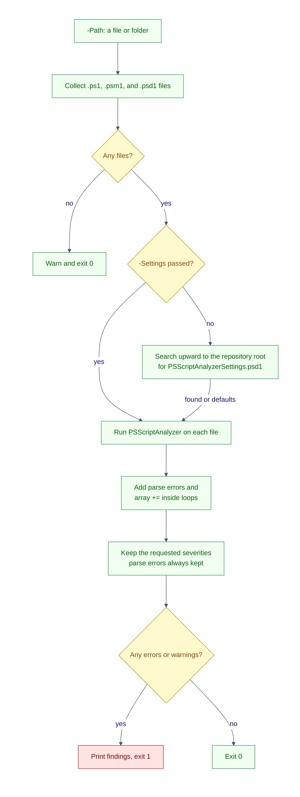
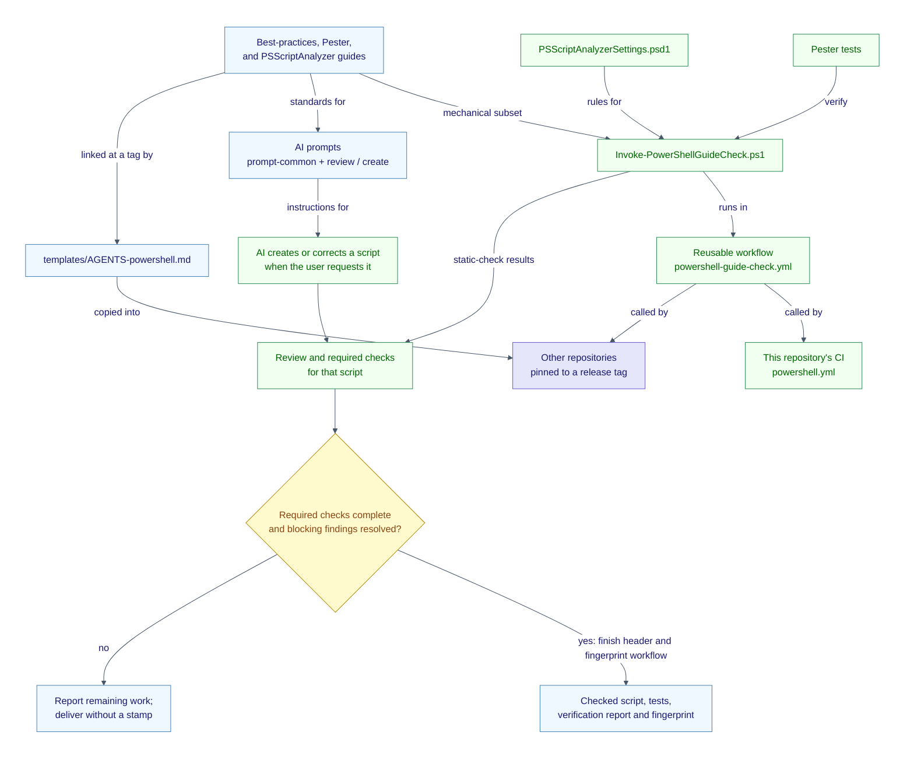
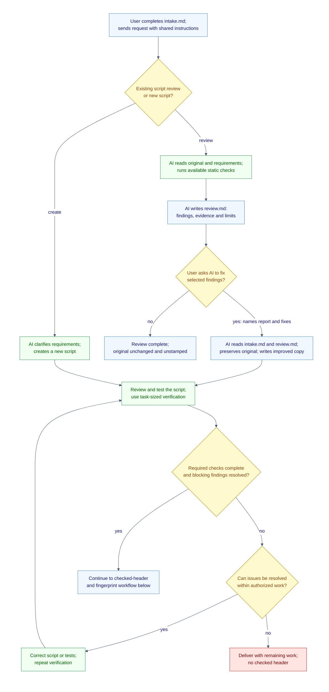
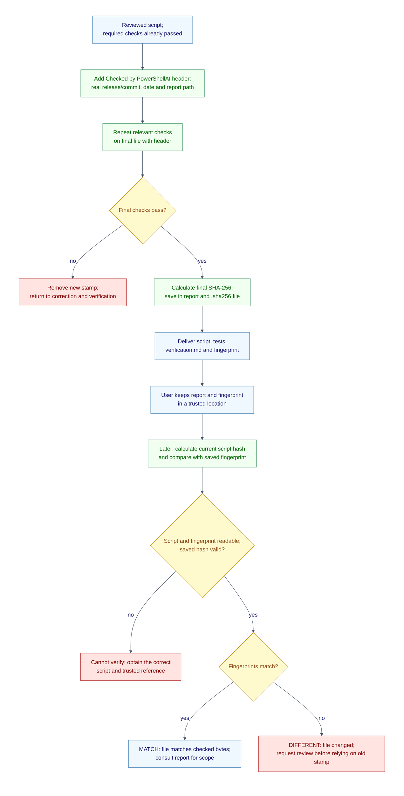
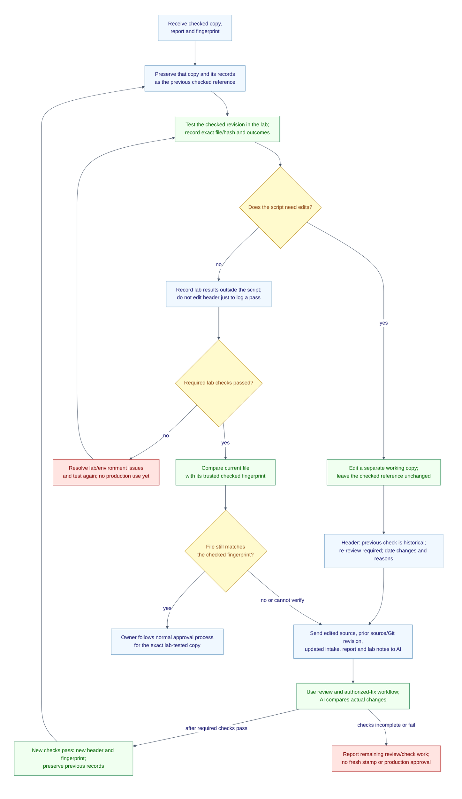
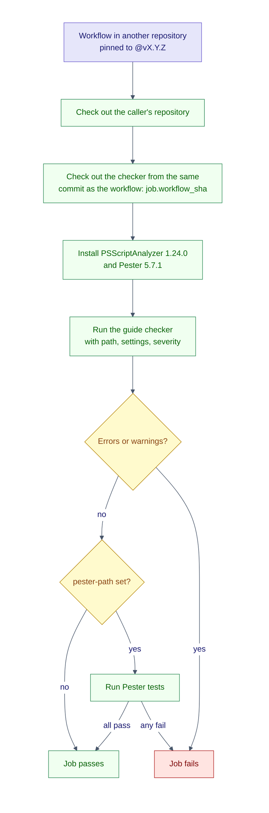

# PowerShell Engineering Guides and Tools

Have a PowerShell script that works, but you are unsure whether it handles errors, avoids unwanted changes, or will be easy to maintain? PowerShellAI helps you review it and make a tested improvement. You can also use it with your AI assistant to create a new script: PowerShellAI gives the assistant a PowerShell best-practices guide to follow and tools to check the code and run tests before it hands the script back.

This project contains writing guides, request templates, a code checker, and examples. **It does not contain an AI assistant.** You use your own AI assistant and give it the instructions and files described below. A *prompt* is simply the request you send to that assistant.

You do not need much AI experience. Start with one script and follow the review steps below.

## Table of contents

- [Why use PowerShellAI with an AI assistant?](#why-use-powershellai-with-an-ai-assistant)
- [Start here](#start-here)
- [Ways to use this project](#ways-to-use-this-project)
- [Fill out a template to start an AI task](#fill-out-a-template-to-start-an-ai-task)
- [Review an existing script](#review-an-existing-script)
  - [1. Save the script and a copy of the review template](#1-save-the-script-and-a-copy-of-the-review-template)
  - [2. Fill out intake.md](#2-fill-out-intakemd)
  - [3. Send the review request to your AI assistant](#3-send-the-review-request-to-your-ai-assistant)
  - [4. Read the review.md report](#4-read-the-reviewmd-report)
  - [5. Ask the AI to use the report to improve the script](#5-ask-the-ai-to-use-the-report-to-improve-the-script)
  - [6. Check the improved copy before using it](#6-check-the-improved-copy-before-using-it)
- [Create a new script](#create-a-new-script)
- [The checked-script header and fingerprint](#the-checked-script-header-and-fingerprint)
  - [Check whether a stamped script has changed](#check-whether-a-stamped-script-has-changed)
- [After lab testing: record changes and ask for another review](#after-lab-testing-record-changes-and-ask-for-another-review)
- [Requirements](#requirements)
- [Check your code with the linter](#check-your-code-with-the-linter)
- [Run the tests](#run-the-tests)
- [Guides and tools](#guides-and-tools)
- [Words used in this README](#words-used-in-this-readme)
- [How the pieces fit together](#how-the-pieces-fit-together)
  - [How a request becomes an improved script](#how-a-request-becomes-an-improved-script)
  - [How the checked copy is identified later](#how-the-checked-copy-is-identified-later)
  - [How lab changes return for another review](#how-lab-changes-return-for-another-review)
- [Use in other repositories](#use-in-other-repositories)
- [Repository layout](#repository-layout)
- [Guide versions](#guide-versions)
- [Appendix: Acronyms and key terms](#appendix-acronyms-and-key-terms)
  - [Acronyms and abbreviations](#acronyms-and-abbreviations)
  - [Key terms](#key-terms)

## Why use PowerShellAI with an AI assistant?

You can ask an AI, "Please review my script." PowerShellAI gives you a more specific starting point and a way to check the answer. It brings together work you would otherwise need to describe and organize yourself.

| What PowerShellAI adds | Why it helps you |
|---|---|
| A form for describing the task | The AI gets your intended behavior, PowerShell version, and limits instead of having to guess them. |
| Written PowerShell standards | You and the AI have the same reference for errors, parameters, file handling, testing, and other decisions. |
| A review process | The instructions ask the AI to inspect first, show evidence, preserve your original, and separate bugs from style suggestions. |
| Checks you can run | PSScriptAnalyzer and the guide checker look for mechanical problems; Pester tests check selected behaviors by running code with controlled inputs. |
| A saved report and verification notes | You can see what the AI found, what changed, which checks actually ran, and what still needs testing. |

Different AI models may notice different problems. The best-practices guide gives each model the same written reference: the "book smarts" for what good PowerShell should look like. Your completed request explains what your particular script should do. The checks and tests provide evidence for the conclusions.

A capable AI can do these things without PowerShellAI if you give it equivalent instructions and tools. This project packages them so you can reuse the process. It does not guarantee that the AI finds every bug or that a passing check makes a script ready for production.

The [worked example](examples/worked-review/README.md) shows why verification matters: the original script passes static checks but fails four behavior tests. The corrected script passes all eight tests.

## Start here

**Get a local copy of this project.** Download and extract its ZIP file from GitHub, or clone it with Git if you already use Git. Open the extracted project folder in your editor. The *project folder*, also called the *repository root*, is the folder containing this README, `prompt-review.md`, and `Invoke-PowerShellGuideCheck.ps1`.

**Choose how to work with your AI assistant.** If it can open local project folders, open this project in it. If you use a chat that cannot read local files, attach or paste the completed request, the script, and the referenced instructions and guides. A message containing a path such as `input/MyScript.ps1` does not give a chat access to that file. Use your organization's approved AI service and remove passwords, tokens, and other unnecessary sensitive information before sharing files.

If your AI only replies in chat, ask it to return the contents of each requested file and save those contents yourself at the paths below. If it cannot run commands, ask it for the commands to run locally and give it the results. It should not claim to have saved files or passed checks it could not perform.

**Choose your task:**

- Have a script already? Follow [Review an existing script](#review-an-existing-script).
- Want a new script? Follow [Create-a-script instructions](#create-a-new-script).
- Want automated checks without AI? Go to [Requirements](#requirements), then [Check your code with the linter](#check-your-code-with-the-linter).
- Want to see a finished example first? Open the [worked review](examples/worked-review/README.md).

You can begin a source review before installing the checking tools. If a tool is unavailable, the AI must say which check it could not run. To run those checks yourself, use the [setup instructions](#requirements).

## Ways to use this project

| Your goal | Where to start |
|---|---|
| Learn better PowerShell habits | Read the [best-practices guide](powershell-best-practices.md) and the [worked example](examples/worked-review/README.md). |
| Find problems in a script you wrote | Complete the review template and follow the [review steps](#review-an-existing-script). |
| Ask AI to write a new script | Complete the creation template and follow the [creation steps](#create-a-new-script). |
| Check code without AI | Run the [guide checker](#check-your-code-with-the-linter) against a named script or folder. |
| Review a script before using it in production | Follow the [pre-production walkthrough](examples/pre-production-review/README.md), including testing in a suitable lab. |
| Use the same standards in another project | Follow [Use in other repositories](#use-in-other-repositories) for shared instructions and automated GitHub checks. |

## Fill out a template to start an AI task

**You fill out one task template.** Keep the original template files unchanged so they can be used again. Files ending in `.md` are plain-text documents; open them in your usual text editor.

| File | What you do |
|---|---|
| [prompt-review.md](prompt-review.md) | Copy and fill this out for an existing script. |
| [prompt-create.md](prompt-create.md) | Copy and fill this out for a new script. |
| [prompt-common.md](prompt-common.md) | Give these shared instructions to the AI with your completed template. You do not fill this file out. |

Replace the parts inside angle brackets, such as `<describe the goal>`, with your information. If you do not know an answer, write "Unknown; please help me establish this." Do not invent a requirement to finish the form.

## Review an existing script

The example paths below use `MyScript.ps1`. Replace `MyScript` with a short name for your script, and keep that name consistent in the folder names and messages.

### 1. Save the script and a copy of the review template

Copy your script into `input/` and keep that copy unchanged during the first review. Create `input/review-MyScript/`, then copy `prompt-review.md` into that folder and name the copy `intake.md`. Here, *intake* means your written description of the task.

If you prefer commands, run these in PowerShell **from the project folder** to create a new request folder and copy the template:

```powershell
New-Item -ItemType Directory -Path ./input/review-MyScript
Copy-Item -LiteralPath ./prompt-review.md -Destination ./input/review-MyScript/intake.md
```

Use a new folder for a new review so you keep earlier requests and reports. To practice without supplying your own script, copy `examples/worked-review/before/Get-LogSummary.ps1` into `input/` and use its actual filename in your request.

### 2. Fill out intake.md

Open `input/review-MyScript/intake.md` in your editor. Fill out the **Task details** section and leave the review instructions below it in place.

| Template field | What to write |
|---|---|
| Script or module to review | The exact path, for example `input/MyScript.ps1`. |
| Requested review or update | For your first pass: "Review only. Explain problems and proposed fixes. Do not change or run the script." |
| Acceptance criteria | What the script must do correctly. For a log counter: "Count only .log files in the chosen folder, ignore subfolders, and report an error if the folder does not exist." Use your own script's requirements. |
| Supported PowerShell versions | The version that must run your script, for example PowerShell 7.6.x or Windows PowerShell 5.1. `$PSVersionTable` shows your current version. |
| Supported operating systems | Where it must work, for example Windows 11. |
| Additional constraints | Required modules, permissions, related files, things it must not change, and whether it may install software or reboot. State what is unknown. |

The AI needs to know what you intended, even if the current script does something different. "Make it better" is not enough to decide whether a change is correct.

### 3. Send the review request to your AI assistant

Send this message to your AI assistant after replacing `MyScript` with your chosen name. If it cannot read local files, attach or paste the files as explained in [Start here](#start-here).

```text
I have put my script at input/MyScript.ps1 and saved my completed review
request at input/review-MyScript/intake.md. Please begin the review.

Read my completed request and follow prompt-common.md, prompt-review.md,
and the PowerShell guides they reference. Keep the original script unchanged.
For this first pass, do not run any part of my script, run its tests, or connect
to the systems it manages. You may read the code and run static code checks.

Save your report to input/review-MyScript/review.md. Explain each problem in
plain language, show the relevant file and line, and suggest a fix. Separate
confirmed bugs from possible risks and style suggestions. Give each finding a
label such as F1 so I can refer to it later. List the checks you
actually ran and anything you could not verify. Ask me about missing details
that affect correctness, while continuing checks that do not need my answer.
If you cannot save files here, return the report for me to save at that path.
```

The AI may ask follow-up questions and report its progress. If you edit the original after this review, tell the AI and ask it to check the changed version before using the old findings. Saving the files alone does not start a review; sending this request does.

### 4. Read the review.md report

Open `input/review-MyScript/review.md`. This is a report, not an improved script. It should explain the problems, their importance, the suggested changes, and what was checked.

Start with confirmed bugs and important risks. A formatting suggestion is different from a defect that could install the wrong updates or report success after a failure. If a finding is unclear, send a question such as:

```text
Read input/review-MyScript/review.md. Explain finding F1 using an example of
what could go wrong. Tell me which change you recommend and whether it would
change how I call the script or what it returns. Do not change files yet.
```

Use the finding name or number from your actual report. Decide which findings to address. Resolve questions about intended behavior before asking the AI to change that behavior.

### 5. Ask the AI to use the report to improve the script

**The AI does not automatically act on review.md.** Send a second request that names the report and the fixes you want. You can continue in the same conversation. In a new conversation, supply the same project, completed intake, source, and report again.

Replace the angle-bracket instruction below with the findings you want fixed, such as "F1 and F3":

```text
Read input/review-MyScript/intake.md and input/review-MyScript/review.md.
Use prompt-common.md and the PowerShell guides to fix these findings:
<list the findings you want fixed>.

Keep input/MyScript.ps1 unchanged. Save the improved script as
input/review-MyScript/after/MyScript.ps1 and its Pester tests under
input/review-MyScript/Tests/. Keep my existing parameter names and output
properties unless we have agreed to change them. Ask about any remaining
unclear requirements before changing the affected behavior.

Run static checks and isolated tests that use temporary files or simulated
external commands. Do not run the script against real systems, install its
operational dependencies, or reboot a machine as part of those tests.

If you cannot save files here, return each file separately with its full path
so I can save it. Save a plain-language account of the changes and check results
to input/review-MyScript/verification.md. Say what still needs testing on the
intended operating system. Follow the shared instructions for the checked header:
only stamp a script after its required checks pass, recheck the stamped file,
and save its final SHA-256 in the report and beside the script as a .sha256 file.
Do not deploy or replace my production script.
```

This authorizes an improved copy and isolated tests. It leaves your original available for comparison. The AI should read the report, make the selected changes, write tests for the relevant behavior, check the result, and explain any remaining limitations.

### 6. Check the improved copy before using it

Read `verification.md` and compare the script in `after/` with your original. Ask the AI to explain changes you do not understand. Check that the report identifies the exact file it tested and gives actual results, rather than just saying "tests should pass."

Have the AI explain what its tests run and how they avoid affecting real systems. Once those tests are confirmed to be isolated, you can repeat the focused checks from the project folder with the [required tools](#requirements) installed:

```powershell
./Invoke-PowerShellGuideCheck.ps1 -Path ./input/review-MyScript/after/MyScript.ps1
Invoke-Pester -Path ./input/review-MyScript/Tests -Output Detailed
```

If a check fails, send the AI the exact command and its output. Ask it to correct the improved copy and repeat the relevant checks. Keep the original unchanged throughout this process.

A passing check is evidence for the behavior it covers. It does not prove the script will work in every environment. Test the improved copy in a suitable test environment before replacing the version you normally run. A Windows-specific script needs Windows testing; running checks on Linux does not establish that its Windows operations work.

Your review folder now has a clear purpose for each file:

| Path | Who creates it and what it is for |
|---|---|
| `input/MyScript.ps1` | You supply the original script. |
| `input/review-MyScript/intake.md` | You complete the task description. |
| `input/review-MyScript/review.md` | The AI writes its findings and proposed fixes. |
| `input/review-MyScript/after/MyScript.ps1` | The AI saves the improved copy when you request fixes. |
| `input/review-MyScript/Tests/` | The AI saves tests for the improved copy. |
| `input/review-MyScript/verification.md` | The AI records changes, checks, results, and remaining work. |
| `input/review-MyScript/after/MyScript.ps1.sha256` | The AI records the final checked script's file fingerprint when a stamp is issued. |

When the required checks pass, the improved script also receives a [checked-script header](#the-checked-script-header-and-fingerprint). If the AI cannot complete those checks, it should explain that and leave the script unstamped. Before using a stamped copy later, [compare its saved fingerprint](#check-whether-a-stamped-script-has-changed).

Files under `input/` are ignored by Git, so an ordinary push will not upload them and GitHub's checks will not test them. Keep the original, intake, reports, and tested revision in your approved internal location. For a production handoff, follow the [pre-production walkthrough](examples/pre-production-review/README.md).

## Create a new script

Use this path when you can describe what you need but do not have a script yet.

1. Create `input/create-MyScript/` and copy `prompt-create.md` there as `intake.md`. You can use the same folder-and-copy commands above with these names.
2. Fill out its Task details: what the script must do, its inputs and outputs, the PowerShell/OS versions, required permissions, and how you will recognize a correct result. For the destination, use `input/create-MyScript/MyScript.ps1` or another explicit working path.
3. Send the following request, replacing `MyScript` with your chosen name and supplying files if the AI cannot read this folder.

```text
I have completed the creation template at input/create-MyScript/intake.md.
Read it and follow prompt-common.md, prompt-create.md, and the referenced guides.
Explain your proposed approach in plain language, and ask about any missing
requirements that affect the result. Then write the script at the destination
in my intake and save appropriate Pester tests under input/create-MyScript/Tests/.

Use static checks and isolated tests. Do not contact real systems, make live
operational changes, or reboot as part of testing. Save the changes, actual test
results, and remaining work to input/create-MyScript/verification.md.
Follow the shared instructions for the checked header and final .sha256 file;
do not issue a stamp when required checks have failed or are incomplete.
```

Read the script and verification notes, ask about unclear choices, and test it in the intended environment before using it for real work. The [checking step above](#6-check-the-improved-copy-before-using-it) explains how to assess the result; substitute the paths used for your new script.

## The checked-script header and fingerprint

After the AI reviews the improved or newly created script and completes its required checks, it adds a short record inside the script's existing help header. For a released version of PowerShellAI, it looks like this:

```text
.NOTES
    Checked by PowerShellAI vX.X.X
    Checked on (UTC): YYYY-MM-DD
    Verification report: ../verification.md
    Verification scope: Source review and isolated tests; see report
```

The AI must fill in the actual version, date, and report location. `vX.X.X` is a placeholder, not a version to copy into a delivered script. If the PowerShellAI copy has unreleased work, the header identifies the Git commit and says whether there are local changes. The report records the material used and the actual checks and results.

The AI then checks the final file again and saves its **SHA-256 fingerprint**: a value calculated from every byte in the file. It puts that value in `verification.md` and in a small file beside the script, such as `MyScript.ps1.sha256`. It does not put the script's own fingerprint inside the script, because writing it there would change the file being measured.

The stamp means the recorded checks were completed for that version of the script. The verification report explains their scope and anything still untested. For example, source review and isolated tests can be complete while lab validation is still pending. The script must still be tested in a suitable lab before production. The code checker does not add the stamp automatically. A review-only request leaves the original script untouched and unstamped.

### Check whether a stamped script has changed

Keep the verification report and fingerprint somewhere trusted, such as your organization's internal version-controlled project. When you receive a script, keep its `.sha256` file with it. The header text alone is not proof: someone can edit it.

Run the following in PowerShell from the project folder, changing `$scriptPath` to the copy you want to check:

```powershell
$scriptPath = './input/review-MyScript/after/MyScript.ps1'
$expectedHash = (Get-Content -LiteralPath "$scriptPath.sha256" -Raw -ErrorAction Stop).Trim()
if ($expectedHash -notmatch '^[A-Fa-f0-9]{64}$') {
    throw 'The saved fingerprint is not a valid SHA-256 value.'
}
$actualHash = (Get-FileHash -LiteralPath $scriptPath -Algorithm SHA256 -ErrorAction Stop).Hash
if ($actualHash -eq $expectedHash) {
    'MATCH: this file matches the saved checked copy.'
} else {
    'DIFFERENT: this file has changed. Ask for another review before relying on its stamp.'
}
```

**MATCH** means the file bytes match the saved fingerprint. **DIFFERENT** means something changed, including a code change, comment edit, or line-ending change. A missing script/fingerprint or an invalid fingerprint raises an error rather than reporting a match. If the `.sha256` file is unavailable, compare `Get-FileHash` output with the value in the trusted verification report.

Do not replace the saved fingerprint with a new one simply to make a mismatch disappear. Have the changed script reviewed and checked again, then issue a fresh header, report, and fingerprint. A hash cannot identify who reviewed the script or protect you if someone can change both the script and its reference records unnoticed.

## After lab testing: record changes and ask for another review

The checked copy is the starting point for lab testing. It is not the end of the process. Use the same operating system, PowerShell version, permissions, and dependencies your script needs. Record which exact script you tested, its saved hash, what you tried, and the actual result.

**If the lab tests pass without editing the script**, add the results to `verification.md` or a separate `lab-notes.md`. There is no need to edit the script just to record a successful lab run. Its fingerprint will still match. Follow your normal approval process before using that exact tested copy in production.

**If you need to edit the script**, keep the last checked copy, report, and fingerprint unchanged. Make a separate working copy, for example `input/review-MyScript/lab/MyScript.ps1`. A different hash is now expected: the working copy is a new revision that has not been checked yet.

In that working copy's help header, replace the active checked record with a note like this. Keep any existing script version or history information, and substitute the real previous identity, date, and paths:

```text
.NOTES
    Review status: Changed since previous check; re-review required
    Previous PowerShellAI check: vX.X.X on YYYY-MM-DD
    Previous verification report: ../verification.md
    Changes since that check:
        YYYY-MM-DD - Explain what changed, why, and what happened in the lab.
    Lab results: ../lab-notes.md
```

You or the AI helping with the edit can write these notes. Use the actual commit identity instead of a release number if the previous check used an unreleased version. The notes help the next reviewer understand your intent; they do not make the old stamp current again. Even a header-only edit changes the hash.

For the next review, create a new request folder such as `input/review-MyScript-r2/`. Copy and update your completed intake there, including any changed requirements. Keep the previous review folder. Then send:

```text
Please review my edited lab copy at input/review-MyScript/lab/MyScript.ps1.
My updated request is input/review-MyScript-r2/intake.md.
The previous checked copy is input/review-MyScript/after/MyScript.ps1,
with its saved .sha256 file beside it. The previous report is
input/review-MyScript/verification.md. My lab results are in
input/review-MyScript/lab-notes.md, and the edited script's header describes
the changes I intended.

Read those files and follow prompt-common.md and prompt-review.md. Compare the
actual changes with the previous checked copy, and review their effect on the
whole script. Do not rely only on my change notes. Keep both copies unchanged
and do not run the script against real systems during this review.
Save the new report to input/review-MyScript-r2/review.md.
```

If your project uses Git, you can supply the previous checked Git revision instead of a separate reference file, provided the AI can access it. If neither is available, the AI can review the current script, but it cannot establish the exact changes from a hash or your notes alone.

Read the new report, then use the [fix request](#5-ask-the-ai-to-use-the-report-to-improve-the-script) with the new paths and selected findings. After the agreed checks pass, the AI adds a fresh checked record to the new output, rechecks it, and saves a new report and fingerprint. Previous check details can remain clearly labeled as history. Take the new copy back to the lab. Keep the earlier checked copy and its records so you can compare versions or return to it if needed.

## Requirements

These tools are needed to run automated checks. You can read the guides and request an initial source review without them. The AI must report any checks it could not run. The version needed to run the checker may differ from the version your own script must support.

- **PowerShell 7 or later.** The check script uses features of PowerShell 7. The scripts you write may still target Windows PowerShell 5.1; the best-practices guide covers the differences.
- **PSScriptAnalyzer 1.24.0** for the linter and the check script.
- **Pester 5.7.1** for automated tests, including this project's examples and the tests created for your script.

Use these exact versions. New versions of PSScriptAnalyzer and Pester can add or change rules, and these are the versions GitHub's checks use (`.github/workflows/powershell-guide-check.yml`), so matching them means you get the same results locally as on GitHub. To install them for your user account from the PowerShell Gallery, run in `pwsh`:

```powershell
Install-Module -Name PSScriptAnalyzer -RequiredVersion 1.24.0 -Scope CurrentUser -Repository PSGallery
Install-Module -Name Pester -RequiredVersion 5.7.1 -Scope CurrentUser -Repository PSGallery -SkipPublisherCheck
```

PowerShell will warn that you are installing from an untrusted repository. That is PowerShell's default setting for the public PowerShell Gallery, not a problem with these modules; answer `Y`. `-SkipPublisherCheck` is needed on Windows, where an older Pester 3.4 signed by Microsoft ships with Windows PowerShell; it is harmless elsewhere. Confirm the installed versions with:

```powershell
Get-Module -ListAvailable PSScriptAnalyzer, Pester | Select-Object Name, Version
```

If your organization uses an internal repository or another approved setup method, use that instead. When you change a pinned version, update both this section and the workflow. The check script never installs modules for you.

## Check your code with the linter

The checker reads PowerShell source and reports likely problems without running the script being checked. From the project folder, check a named file like this:

```powershell
./Invoke-PowerShellGuideCheck.ps1 -Path ./input/MyScript.ps1
```

Replace that example path with the file you want checked. You can also name a folder to check its `.ps1`, `.psm1`, and `.psd1` files recursively. A check of the entire project (`-Path .`) also includes local scripts under `input/`.

Each reported problem, called a *finding*, is one line: `file:line:column: [Severity] Rule: message`.

- **Errors and warnings** make the check fail (exit code 1). Read each finding, fix relevant problems, and document justified exceptions. A formatting warning and a demonstrated behavior bug need different attention.
- **Information** findings are worth reading but do not make the check fail.

Which rules apply comes from `PSScriptAnalyzerSettings.psd1`. The script uses the nearest one, searching upward from the folder you check to the repository root, unless you name a file with `-Settings`.

The array-append check keeps variable names separate across functions to avoid confusing an array with an unrelated counter. It does not track runtime types or control flow.

The check cannot tell whether your script does what you intended, or whether it is safe in your environment. That still needs tests and review. This checker reports findings; it does not add the checked header or create a fingerprint.



## Run the tests

The tests in `Tests/` check this repository's own check script. They make sure it still catches the problems it should; if it had a bug, it could report a clean result for bad code. The [worked example](examples/worked-review/README.md) has a separate test suite for its corrected script. Neither suite tests your own scripts; write Pester tests for them as the [Pester testing guide](powershell-pester-testing.md) describes.

To test this project's own checker and worked example, run from the project folder:

```powershell
Invoke-Pester -Path ./Tests,./examples/worked-review/Tests -Output Detailed
```

To test your improved script, use the focused path under `input/review-MyScript/Tests/` described above. A broad test search from `.` may also discover local tests you have placed under `input/`.

The checker tests run the check script in a separate `pwsh` process, so PSScriptAnalyzer must be installed for that process too.

GitHub Actions runs the check script and these tests automatically on both Ubuntu and Windows for every push and pull request, so a change that breaks either platform is caught before anyone relies on it. The tool versions are pinned, so a new release of PSScriptAnalyzer or Pester cannot silently change the results. This repository's CI uses the same reusable workflow that other repositories use (see below), so every push here also tests that workflow.

A separate Ubuntu job runs the Mermaid audit tool's unit tests with Python 3.13 and PyYAML 6.0.4. These tests check the diagram tooling without installing a browser or rendering diagrams. See the [audit scripts README](reference/scripts/README.md) for setup and the command to run them locally.

## Guides and tools

- [PowerShell Best Practices](powershell-best-practices.md): the main standard. It covers naming, parameters, error handling, security, previewing changes with `-WhatIf`, testing, and rules for AI agents. Shared rules make scripts predictable and easier to review, and they give an AI a concrete standard to follow instead of its own habits.
- [Pester testing guide](powershell-pester-testing.md): how to write and run tests with Pester. Tests show that a script does what it should and keeps doing it after later changes. Scripts that change systems need them most.
- [PSScriptAnalyzer guide](powershell-psscriptanalyzer.md): how to set up and use the linter. A linter catches common mistakes automatically, before anyone spends time reviewing the code.
- [PSScriptAnalyzer documentation](https://learn.microsoft.com/en-us/powershell/utility-modules/psscriptanalyzer/using-scriptanalyzer?view=ps-modules) (Microsoft): the official reference, for when you need details about a rule that the guide does not cover.
- [Guide check script](Invoke-PowerShellGuideCheck.ps1) (`Invoke-PowerShellGuideCheck.ps1`): runs PSScriptAnalyzer plus a few extra checks for guide rules that PSScriptAnalyzer does not cover, such as code that cannot be parsed and arrays grown inside loops, which is slow. It gives you one command for every automated check, and it runs the same way on your computer and on GitHub.
- [Shared AI prompt](prompt-common.md): rules for every AI task. It sets how much checking a task needs, how to verify the work, and how to report results honestly. Without these rules, an AI may skip tests or claim that checks passed when it never ran them. It builds on the "Rules for AI agents" section of the best-practices guide.
- [AI script review prompt](prompt-review.md): asks the AI to review an existing script, usually one you put in `input/`. The AI reports findings by severity with evidence, and keeps real bugs separate from style suggestions.
- [AI script creation prompt](prompt-create.md): asks the AI to design and write a new script from your requirements, including tests, instead of producing code with no plan or tests.
- [Mermaid conventions](reference/mermaid-best-practices.md): how AI agents draw, render, and check flowcharts of PowerShell scripts. When every diagram follows the same rules, unhandled branches, skipped cleanup, and changes that bypass `-WhatIf` are easier to spot during review. This README's diagrams follow them too.

## Words used in this README

- **Module**: a packaged set of PowerShell commands that can be installed and shared, such as Pester.
- **Linter (static analysis)**: a tool that reads code without running it and flags likely mistakes. PSScriptAnalyzer is the standard linter for PowerShell.
- **Pester**: PowerShell's testing framework. A test runs code and checks that the result is what you expected.
- **CI (continuous integration)**: checks that run automatically on GitHub every time someone pushes a change. This repository uses GitHub Actions for CI.
- **AI agent**: an AI assistant, such as Claude or GitHub Copilot, that can read files and run commands in a repository.
- **Release tag**: a fixed name, such as `v1.2.0`, for one exact version of this repository. A tag never changes, so anything that refers to it gets the same files every time.
- **Mermaid**: a text format for diagrams. GitHub draws Mermaid text as a picture, which is how the diagrams below appear.

GitHub renders the diagrams on the README page. In VS Code, open the Markdown Preview with **Ctrl+Shift+V**; the regular editor shows the Mermaid text.

## How the pieces fit together

Read this diagram from top to bottom. The guides at the top define the rules; everything below them uses those rules.



Colors are the same in every diagram: blue for documents and prompts, green for scripts, settings, and CI steps, purple for other repositories, yellow for decisions, and red for failure paths.

### How a request becomes an improved script

The shared AI instructions scale the amount of work to the task. A small change gets a separate checking pass; complex work calls for independent review where available. The AI should report which checks and review steps it actually completed.



### How the checked copy is identified later

The header is added before the final checks. The fingerprint is calculated after all script edits, so it includes the header. A missing or invalid reference is a verification error, not a match.



### How lab changes return for another review

A new hash after an intentional lab edit is expected. Change notes explain the reason for the edit, while the previous checked source lets the AI see the real differences. The earlier reference and records stay intact.



## Use in other repositories

Another PowerShell repository can use these standards and checks without copying this whole repository.

**Always refer to a release tag**, such as `v1.2.0`, not to the `master` branch. A tag never changes, so your project keeps the exact rules it was tested with until you choose to upgrade. `master` changes whenever this repository changes, and a new rule could suddenly make your checks fail.

**AI agent instructions.** Many AI coding assistants automatically read a file named `AGENTS.md` or `CLAUDE.md` when they start working in a repository. Copy the section in [templates/AGENTS-powershell.md](templates/AGENTS-powershell.md) into that file in the other repository. It points the AI to these guides at a fixed tag and tells it which checks to run, so the AI follows the same standards there.

**Local checks.** The template includes copy-and-run PowerShell commands that download the checker from the same release as CI into a temporary directory, run it with the pinned analyzer, and optionally run Pester with failing exit codes. Running PSScriptAnalyzer alone skips the checker's supplemental rules. Use the same paths, settings, and severities locally as in your workflow.

**CI.** A reusable workflow is a GitHub Actions workflow that other repositories can call instead of writing their own. To run the check script, and optionally Pester, on every push in another repository, add a workflow file there like this:

```yaml
name: PowerShell

on:
  push:
  pull_request:

permissions:
  contents: read

jobs:
  powershell:
    uses: scufflegrits/powershellai/.github/workflows/powershell-guide-check.yml@v1.2.0
    with:
      pester-path: ./Tests   # omit to skip Pester
```

Optional inputs: `path` (default `.`), `settings` (default: nearest `PSScriptAnalyzerSettings.psd1`, otherwise PSScriptAnalyzer defaults), `severity` (default `Error,Warning`), and `os` (JSON array, default `["ubuntu-latest", "windows-latest"]`). The workflow uses the check script and tool versions from the tag you pin. To apply this repository's analyzer rules there too, copy [PSScriptAnalyzerSettings.psd1](PSScriptAnalyzerSettings.psd1) into the other repository's root.

Each job of the reusable workflow runs these steps once for every operating system in `os`. It reports CI results; the AI's checked-header and fingerprint delivery steps are separate:



## Repository layout

- `.github/workflows/`: the automated checks GitHub runs. `powershell-guide-check.yml` is the reusable workflow that other repositories call; `powershell.yml` runs it for this repository.
- `templates/`: text to copy into other repositories, so they can use these guides without copying this whole repository.
- `reference/`: supporting material for AI-assisted code review. The Mermaid conventions make agents diagram a script the same way every time: one node per decision, side effect, or exit path, with every branch labeled, and each diagram rendered and checked before it is delivered. A reviewer can then compare the diagram with the code to find paths the code doesn't handle. The diagram is a review aid, not a substitute for tests. `reference/scripts/` holds an optional tool that audits these diagrams.
- `input/`: put a script here when you ask an AI to review it with the review prompt, so the AI knows which file to look at. Git ignores everything in this folder, because a script under review may contain internal names or secrets that must not reach this public repository.
- `Tests/`: Pester tests for the check script (not for your scripts).
- `examples/worked-review/`: a complete review walkthrough with original and corrected scripts and shared behavior tests.
- `examples/pre-production-review/`: instructions for taking a script from `input/` through an AI review, authorized fixes, lab verification, and a production handoff.
- `PSScriptAnalyzerSettings.psd1`: which analyzer rules this repository enforces, such as consistent indentation and brace placement. Copy it to another repository to apply the same rules there.
- `CHANGELOG.md`: what changed in each version, so you can see what an upgrade brings before you take it.
- `RELEASING.md`: maintainer steps for publishing a new version safely.
- `HANDOFF.md`: notes for a maintainer resuming work, possibly on another machine: how to check the current state, the owner's working rules, and setup tips. You don't need it to use the guides.

## Guide versions

Each guide shows its version near the top, for example `**Guide version:** 1.1.0`. The version goes up whenever the guide changes, so you can tell whether two people are working from the same rules. Filenames never change, so links to a guide keep working.

To see what changed, read [CHANGELOG.md](CHANGELOG.md). To see an earlier version of a guide, check out a release tag or run `git log -- <guide>.md`. Maintainers publishing a new version should follow [RELEASING.md](RELEASING.md).

## Appendix: Acronyms and key terms

### Acronyms and abbreviations

| Acronym or abbreviation | Full form | Meaning in this document |
|---|---|---|
| AI | Artificial intelligence | Assistants that use the guides and prompts to write or review PowerShell. |
| CI | Continuous integration | Automated checks that GitHub Actions runs when changes are pushed or proposed. |
| ELK | Eclipse Layout Kernel | A diagram layout engine mentioned in the Mermaid source comments; this README uses dagre instead. |
| JSON | JavaScript Object Notation | The format used for the workflow's operating-system list, such as `["ubuntu-latest", "windows-latest"]`. |
| OS | Operating system | A platform on which checks run, such as Ubuntu or Windows; `os` is a workflow input. |
| SVG | Scalable Vector Graphics | A vector image format produced by diagram tools and handled by the audit tool's background helper. |
| TD | Top-down | The Mermaid direction setting that arranges a flowchart from top to bottom. |
| YAML | YAML Ain't Markup Language | The configuration format used by GitHub Actions workflows and the Mermaid configuration blocks. |

### Key terms

| Term | Plain-language definition | How it applies here |
|---|---|---|
| AI agent | An AI assistant that can read files and use tools to carry out a task. | Follows the guides, uses the review or creation prompt, and reports evidence from checks. |
| Array | An ordered collection of values. | The checker can flag arrays grown with `+=` inside loops, a pattern that can cause repeated copying. |
| Commit | A recorded set of changes in Git, identified by a unique identifier. | A release tag points to a commit so consumers can select a particular version of the guides and tools. |
| Consumer repository | Another project that uses shared material from this repository. | Copies the agent-instruction template and calls the reusable workflow at a pinned release. |
| Exit code | A number a process returns to indicate its result. | The guide checker returns `1` for errors or warnings and `0` when no failing findings remain. |
| Finding | A reported problem or item that needs review. | Includes a file location, severity, rule name, and explanation. |
| Git | A tool that records and tracks changes to files. | Keeps the repository's history and release tags and ignores local review scripts in `input/`. |
| GitHub Actions | GitHub's service for running automated workflows. | Runs the checker, Pester tests, and Mermaid unit tests on designated runners. |
| Job | A group of workflow steps executed on a runner. | The PowerShell checks run for each selected operating system; Mermaid unit tests have a separate Ubuntu job. |
| Linter / static analysis | A tool or method that examines code without executing it to find likely mistakes. | PSScriptAnalyzer checks PowerShell rules; it cannot prove that a script behaves correctly. |
| Mermaid | A text format for describing diagrams. | Draws the flowcharts that explain how the guides, prompts, checker, and workflows fit together. |
| Module | A package of PowerShell commands that can be installed and shared. | PSScriptAnalyzer and Pester are the modules required for analysis and testing. |
| Parser error | A syntax problem that prevents code from being read as a valid program. | The guide checker always reports PowerShell parser errors, regardless of the requested severities. |
| Pester | A testing framework for PowerShell. | Tests the checker and worked example here; consumers write their own Pester tests for their scripts. |
| Pinned version | A deliberately selected version rather than whichever version happens to be newest. | Release references and module versions keep checks consistent until an intentional upgrade. |
| PowerShell Gallery | A public repository of PowerShell modules and scripts. | Supplies the pinned PSScriptAnalyzer and Pester modules through the documented install commands. |
| Prompt | Instructions and task details given to an AI assistant. | The shared prompt supplies workflow rules; the review and creation prompts define the requested work. |
| PSScriptAnalyzer | A static-analysis module for PowerShell. | Supplies most automated rules, with repository settings controlling which rules apply. |
| Pull request | A proposed set of repository changes submitted for review. | Triggers CI so problems can be found before the changes are merged. |
| `pwsh` | The command used to start PowerShell 7. | Runs local commands and the separate processes used by the checker tests. |
| Release tag | A named Git reference identifying a published version. | Consumers use tags such as `v1.2.0`; this project's release policy forbids moving a published tag. |
| Repository | A project's files together with their recorded Git history. | Holds the guides, prompts, scripts, tests, and workflow configuration. |
| Repository root | The top-level folder of a repository. | The starting location for documented commands and the boundary for automatic settings discovery. |
| Reusable workflow | A GitHub Actions workflow that other workflows can call. | Lets this repository and consumers run the same PowerShell checker and optional Pester tests. |
| Runner | The machine or environment that executes a GitHub Actions job. | Provides the Ubuntu or Windows environment used for automated checks. |
| Scope | The context in which a variable name is used. | Array-append detection distinguishes script-level variables from variables in separate functions. |
| Severity | The importance assigned to a finding. | Errors and warnings fail the check; informational findings are review items that do not fail it. |
| Supplemental check | An additional check beyond the analyzer's rules. | The guide checker adds parser-error reporting and an array-append check. |
| Unit test | An automated test focused on a small part of a tool's behavior. | The Mermaid tests check the audit tool's source checks and SVG background helper without rendering diagrams. |
| `-WhatIf` | A PowerShell option that previews supported changes without making them. | The guides promote it for safe operations, and review diagrams help reveal paths that bypass its protection. |
| Workflow | A configuration describing automated jobs and when they run. | Files in `.github/workflows/` define this repository's CI and the checks consumers can reuse. |
