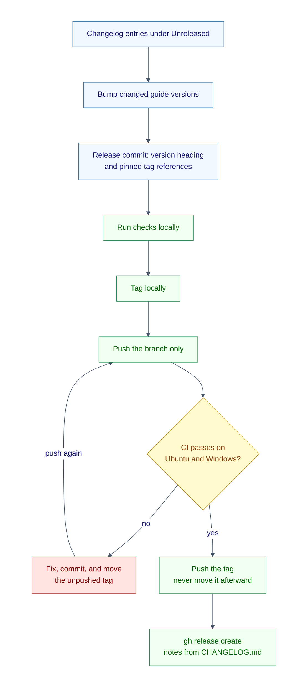

# Releasing

Other repositories pin this one by tag: they call `powershell-guide-check.yml@vX.Y.Z`, and `templates/AGENTS-powershell.md` links the guides at a tag. A published tag must therefore point to a commit that passed CI, and it must never move.

Run each push (`git push`) as its own command. Do not chain it with commits, tagging, or CI watching. Each step that publishes something can then be seen and approved on its own, and AI agents' permission checks may block a combined command that includes a push.

## Overview



## Steps

1. **Record changes as they land.** Add entries under `## [Unreleased]` in [CHANGELOG.md](CHANGELOG.md).

2. **Bump guide versions.** For each guide that changed, update its `**Guide version:**` header following the versioning policy in §14 of the best-practices guide: a new rule or section is MINOR; clarifications and errata are PATCH. Filenames stay the same.

3. **Prepare the release commit.**
   - Rename `## [Unreleased]` to `## [X.Y.Z] - YYYY-MM-DD` and add a new, empty `## [Unreleased]` above it.
   - Update the pinned tag in [README.md](README.md) (the "Use in other repositories" example and the "Guide versions" section) and in [templates/AGENTS-powershell.md](templates/AGENTS-powershell.md) to `vX.Y.Z`, so the tagged commit points to itself.
   - Commit these changes.

4. **Run the checks locally.**

   ```powershell
   ./Invoke-PowerShellGuideCheck.ps1 -Path .
   Invoke-Pester -Path ./Tests -Output Detailed
   ```

5. **Tag locally; do not push the tag yet.**

   ```bash
   git tag -a vX.Y.Z -m "Release X.Y.Z"
   ```

6. **Push the branch and wait for CI.** This repository's remote is named `main`, and the branch is `master`.

   ```bash
   git push main master
   gh run list --branch master --limit 1
   gh run watch <run-id> --exit-status
   ```

   Both the Ubuntu and Windows jobs must pass. To read a job's output, use `gh api repos/scufflegrits/powershellai/actions/jobs/<job-id>/logs`; `gh run view --log` returns nothing for jobs run by the called workflow.

   If CI fails, fix the problem, commit, and move the unpushed tag with `git tag -f -a vX.Y.Z -m "Release X.Y.Z"`. Repeat until CI passes.

7. **Push the tag.**

   ```bash
   git push main vX.Y.Z
   ```

   Never move or delete a tag after pushing it. If a published release needs fixing, release a new version.

8. **Create the GitHub release.** Use the `[X.Y.Z]` section of the changelog from the tagged commit as the notes, so the release and the changelog match exactly:

   ```bash
   git show vX.Y.Z:CHANGELOG.md \
     | awk '/^## \[X\.Y\.Z\]/{f=1;next} /^## \[/{f=0} f' \
     | sed -e '/./,$!d' > release-notes.md
   gh release create vX.Y.Z --title "vX.Y.Z" --verify-tag --notes-file release-notes.md
   rm release-notes.md
   ```

   `--verify-tag` makes the command fail instead of creating a new tag if the tag has not been pushed. A release is public, and repository watchers are notified.
